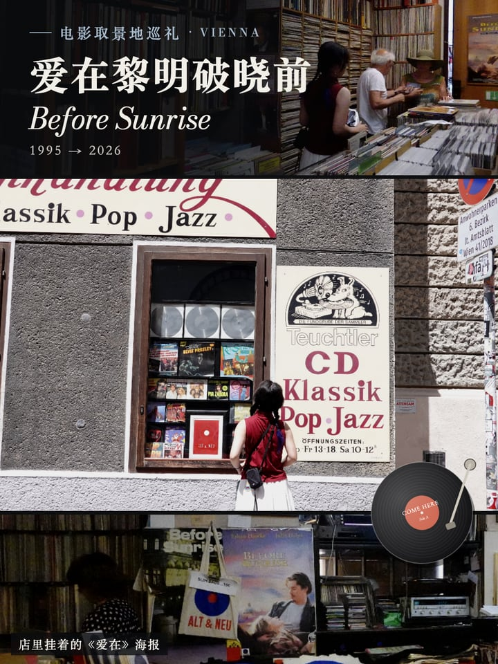
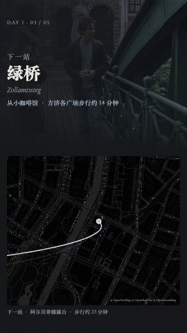
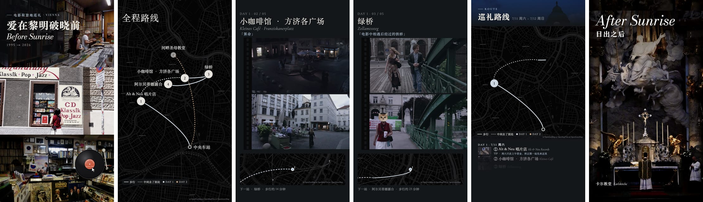

# film-pilgrimage · Film location pilgrimage videos

**English** | [中文](README.zh-CN.md)

A skill for [Claude Code](https://claude.com/claude-code) that turns your "movie still vs. my photo" shots from a film-location trip into a social-media-style vertical video (1080×1920), plus a 3:4 feed cover.

- At each location: a walking card with a mini map → the film still → your photo revealed → both shown side by side
- An animated route map at the start, a route card at the end, and a scenery montage
- Music can be aligned so a chosen beat lands on a cut
- One look per film (35mm filmstrip, paper scroll, …); the cover and opening are designed per film

The engine is the [Remotion](https://www.remotion.dev) project in `template/`. `SKILL.md` is the production workflow Claude follows, and `lessons.md` collects the pitfalls we hit along the way. The skill's instructions are written in Chinese, but Claude follows them in any language.

## Example: *Before Sunrise* · Vienna

<p>
  
  &nbsp;
  
</p>

[](https://wenyufan.vercel.app/files/projects/film-pilgrimage/before-sunrise.mp4)

▶ **[Watch the full video](https://wenyufan.vercel.app/files/projects/film-pilgrimage/before-sunrise.mp4)** (1080p, silent — the original soundtrack is copyrighted)

The example runs as-is: its data and photos ship inside `template/`.

```bash
cd template && npm i && npm run dev     # open BeforeSunrise in Remotion Studio
```

## Install

You need Claude Code and Node.js 20+.

Put the `film-pilgrimage` folder (this repo) in `~/.claude/skills/` (Windows: `C:\Users\<you>\.claude\skills\`) and restart Claude Code:

```bash
git clone https://github.com/fanwy16/film-pilgrimage ~/.claude/skills/film-pilgrimage
```

No GitHub account? Use **Code → Download ZIP** on this page, unzip, and rename the folder to `film-pilgrimage`. Then tell Claude something like "make a film-location pilgrimage video for *&lt;film&gt;*".

Optional: install Remotion's official skills (`remotion-dev/skills`, listed in `template/skills-lock.json`) so Claude writes better Remotion code.

## What you need

- Comparison images: one per location, film still on top and your photo from the same angle below
- Trip notes: where you went each day, in what order
- Scenery photos and music

The *Before Sunrise* data is in `template/src/data/before-sunrise.json`, with photos in `template/public/raw/`. *The Sound of Music* (Salzburg, including two music cues aligned to cuts) is JSON only, in `template/examples/`, as a format reference. The repo contains no music files.

## Copyright and license

- The code is released under the MIT License (see `LICENSE`).
- Example photos and video © Wenyu Fan. You may use them to run and learn from this template; please ask before republishing them.
- Film stills in the comparison images belong to their rights holders and are shown here for comparison and commentary only.
- **Remotion has its own license**: free for individuals, non-profits and companies of up to 3 people; larger companies need a company license. See https://www.remotion.dev/license.
- Maps come from OpenFreeMap / OpenStreetMap. Credit "© OpenStreetMap contributors" when you publish a video.
- Film stills and music belong to their owners; check that your use is allowed (platforms may mute original soundtracks).
- Chinese text uses the system Songti font (macOS "Songti SC"); Latin fonts come from Google Fonts (OFL).
