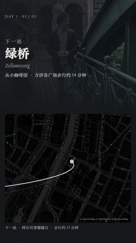
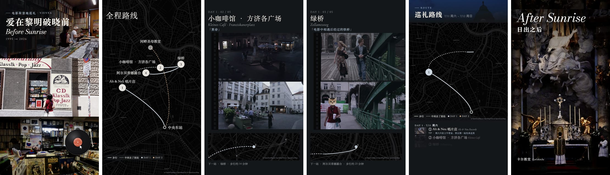

# film-pilgrimage · 电影取景地巡礼视频 skill

[English](README.md) | **中文**

一个 agent skill（Claude Code、Codex 等支持 `SKILL.md` 的 agent 都能用）：把旅行中拍的「电影原片 vs 实景」对比图，做成社交媒体风格的竖屏视频（1080×1920），附 3:4 封面。

- 每个取景地：步行卡 + 小地图 → 原片 → 揭开实景 → 上下并排
- 开头的全程路线动画、结尾的路线卡、风景蒙太奇
- 音乐可以把某一拍对齐到某个画面切换
- 每部片一套风格（胶片 / 卷轴…），封面和开场单独设计

引擎是 `template/` 里的 [Remotion](https://www.remotion.dev) 项目；`SKILL.md` 是给 Claude 看的制作流程，`lessons.md` 是踩过的坑。

## 示例：《爱在黎明破晓前》· 维也纳

<p>
  
  &nbsp;
  
</p>

[](https://wenyufan.vercel.app/files/projects/film-pilgrimage/before-sunrise.mp4)

▶ **[观看完整成片](https://wenyufan.vercel.app/files/projects/film-pilgrimage/before-sunrise.mp4)**（1080p 无声版，原声音乐有版权所以去掉了）

这个例子可以直接跑：`template/` 里自带它的数据和照片。

```bash
cd template && npm i && npm run dev     # 在 Studio 里打开 BeforeSunrise
```

## 安装

需要一个支持 skill 的 agent（比如 Claude Code）和 Node.js 20+。

把 `film-pilgrimage` 文件夹（也就是这个仓库）放到你的 agent 读取 skill 的位置。Claude Code 是 `~/.claude/skills/`（Windows：`C:\Users\<用户名>\.claude\skills\`），然后重启 Claude Code：

```bash
git clone https://github.com/fanwy16/film-pilgrimage ~/.claude/skills/film-pilgrimage
```

没有 GitHub 账号也可以：在本页点 **Code → Download ZIP**，解压后把文件夹改名为 `film-pilgrimage`。装好后对 Claude 说「帮我做一个 XX 电影的取景地巡礼视频」。也可以直接把 zip 拖给 Claude Code，让它帮你装。

可选：安装 Remotion 官方 skills（`remotion-dev/skills`，列在 `template/skills-lock.json`），Claude 写 Remotion 代码会更顺。

## 你需要准备

- 对比图：每个取景地一张，上半电影截图、下半同角度实拍
- 行程笔记（每天去了哪、什么顺序）
- 风景照、音乐

《爱在》的数据在 `template/src/data/before-sunrise.json`，照片在 `template/public/raw/`；《音乐之声》（萨尔茨堡，带两段音乐对齐的写法）只有 JSON，在 `template/examples/`，用来参考格式。仓库里没有任何音乐文件。

## 版权和许可

- 本仓库代码以 MIT 许可发布（见 `LICENSE`）。
- 示例照片和视频 © Wenyu Fan，可以用来运行、学习这个模板；转载或二次发布请先联系作者。
- 对比图里的电影画面版权属于电影版权方，这里只作对比和评论用途。
- **Remotion 有自己的许可**：个人、非营利组织和 3 人以下公司可以免费使用；更大的公司需要购买许可。详见 https://www.remotion.dev/license 。
- 地图来自 OpenFreeMap / OpenStreetMap。发布视频时请注明「© OpenStreetMap contributors」。
- 电影截图、音乐的版权属于原作者，请自行确认你的使用方式（平台可能会静音原声）。
- 中文字体用系统自带的宋体（macOS「Songti SC」），英文字体来自 Google Fonts（OFL）。
