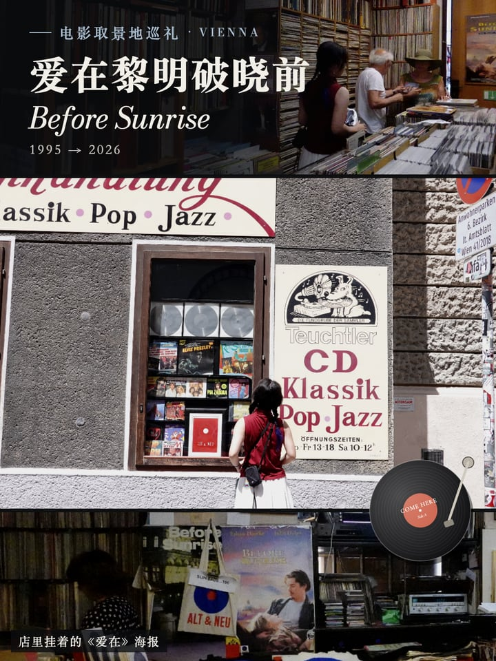
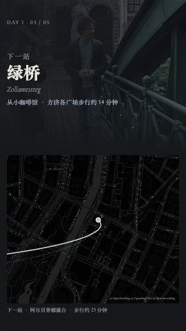
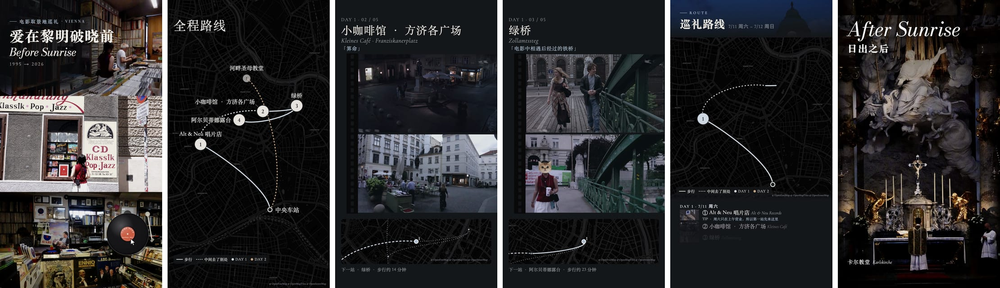

# Film pilgrimage · Remotion template

**English** | [中文](#中文)

The video engine behind the film-pilgrimage skill: "movie still vs. my photo" at each filming location, an animated walking route, a scenery montage, a route card, and a 3:4 feed cover. It ships with a runnable example, *Before Sunrise* (Vienna).

<p>
  
  &nbsp;
  
</p>

[](https://wenyufan.vercel.app/files/projects/film-pilgrimage/before-sunrise.mp4)

▶ **[Watch the full video / 观看完整成片](https://wenyufan.vercel.app/files/projects/film-pilgrimage/before-sunrise.mp4)** (1080p, silent / 无声版)

```bash
npm i
npm run dev                     # Remotion Studio → BeforeSunrise
npx remotion render BeforeSunrise out/before-sunrise.mp4 --gl=angle
```

- Film data: `src/data/<film>.json` (registered in `src/data/index.ts`; fields documented in `src/types.ts`)
- Look and pacing: `src/theme.ts`
- Photos: `public/raw/<film>/`, music: `public/music/` (none included)
- Workflow and rules: [`../SKILL.md`](../SKILL.md), pitfalls: [`../lessons.md`](../lessons.md)

---

## 中文

电影取景地巡礼 skill 的视频引擎：每个取景地「原片 vs 实景」对比、步行路线动画、风景蒙太奇、路线卡，以及 3:4 封面。自带一个可以直接运行的示例：《爱在黎明破晓前》· 维也纳（截图和视频见上方）。

```bash
npm i
npm run dev                     # Remotion Studio → BeforeSunrise
npx remotion render BeforeSunrise out/before-sunrise.mp4 --gl=angle
```

- 每部片的数据：`src/data/<film>.json`（在 `src/data/index.ts` 注册，字段说明见 `src/types.ts`）
- 风格和节奏：`src/theme.ts`
- 照片放 `public/raw/<film>/`，音乐放 `public/music/`（仓库里没有音乐）
- 制作流程和规则：[`../SKILL.md`](../SKILL.md)，踩过的坑：[`../lessons.md`](../lessons.md)
